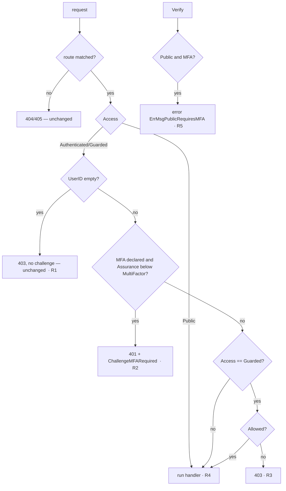

> This plan is dispatched via the CodeJob workflow. See skill: agents-workflow.

# Plan — router: multi-factor routes and the public-route inventory

Master plan: `SECURITY_BY_DEFAULT_MASTER_PLAN.md` in the maintainer's workspace
(not published; everything you need is restated here).

## Why

An identity provider (`veltylabs/iam`) needs its admin plane to accept only
callers who proved a **second, phishing-resistant factor** (a passkey). Today
`router` can say "anyone", "any identity" or "identity + permission", but not
"proven with two factors". The app therefore had to leave the framework and
check by hand inside handlers. A forgotten check would then be an open
endpoint, and introspection would not show it. This plan makes MFA a typed,
declared, enforced property of a route, the same way access already is.

It also adds a test helper that pins the exact set of public routes of an
app (OWASP API Security Top 10 2023, API9 "Improper inventory management").

Prior art this follows:
- RFC 9470 (OAuth 2.0 Step-Up Authentication Challenge).
- OIDC `acr`/`amr` claims.
- ASP.NET Core authorization policies requiring `amr=mfa`.
- Spring Security 7 factor authorities.
- django-otp `otp_required`.

## Dependency

`webtyp.com/model` must already export `model.Assurance` (added in-session by
the planner before this plan is dispatched). Its exact shape, for reference:

```go
// Assurance is how strongly the identity of a request was proven
// (NIST SP 800-63B authenticator assurance levels).
type Assurance uint8

const (
	AssuranceNone         Assurance = iota // anonymous
	AssuranceSingleFactor                  // one factor: a session cookie, a client assertion
	AssuranceMultiFactor                   // a second, phishing-resistant factor: a passkey
)

func (a Assurance) String() string // "none" | "single_factor" | "multi_factor"
```

Bump it with `go get webtyp.com/model@latest` in stage 1. If `model.Assurance`
does not exist in the latest tag, **stop**: do not declare it locally.

## Constraints (from AGENTS.md, restated)

- This library declares the routing **contract** only and implements no
  server. Its only dependency is `webtyp.com/model` (plus `webtyp/fmt` and
  `webtyp/json` already in `go.mod`). Do not add others.
- Isomorphic: no build tags, no `net/http` in the public surface. It compiles
  for native Go and for WebAssembly (TinyGo).
- **No `map` in code that compiles to WASM.** Use slices + linear scan.
  **No stdlib `strings`/`strconv`/`errors`**: use `webtyp.com/fmt`.
  `routertest` is the only exception: it is test-support code that imports
  `testing`. It still uses `webtyp/fmt`, not `strings`.
- Typed over `any`. No boolean parameters. Every repeated string is a named
  constant.
- Tests go in `tests/` (external package `tests`, public API only). Never
  export a symbol only so a test can reach it. Run with `gotest` (not `go
  test`). It runs vet, race, stdlib and WASM suites.

## Design gate

1. **Prior art.** See "Why". RFC 9470 defines exactly the challenge used here:
   `401` + `WWW-Authenticate: Bearer error="insufficient_user_authentication"`.
   ASP.NET and Spring express MFA as an authorization requirement evaluated
   by the framework, not by the handler. That is the property kept here. This
   ecosystem differs in declaring it per route at registration, as `Access`
   already is, so that introspection shows it without running the request.
2. **Novice names.**
   - `r.Post(p, h).Requires(res, act).RequiresMFA()` reads as "this route
     requires MFA".
   - `ctx.SetAssurance(model.AssuranceMultiFactor)` reads as "this request's
     identity was proven with multiple factors".
   - `routertest.AssertPublicRoutes(t, r, "GET /api/health")` follows the Go
     convention of `httptest`/`fstest`.
   - No abbreviations beyond `MFA`, which is universal.
3. **Complexity ledger.**
   - Concepts: +2 (`Assurance`, `RequiresMFA`). Apps lose the hand-written
     MFA/admin wrappers they currently need, a net −1 for iam.
   - Files to touch to protect a route with MFA: 1 (the route line), was N
     handlers.
   - Lines at the call site: +1 method call per MFA route.
   - Ways to do the same thing: 0. There is no other MFA mechanism in the
     ecosystem; iam's hand-rolled one is deleted in its own plan.
4. **Where it belongs.** The route contract owns access declarations, so MFA
   belongs here. `Context` already carries the identity (`SetUserID`), so the
   assurance of that identity goes next to it. Enforcement belongs to each
   implementer (httpd, edge), and the shared contract is proven by
   `conformance`.
5. **What it deletes.** Nothing in this repo. It makes deletable iam's
   `RequirePanelAdmin`/email-list wrapper and every hand-written MFA check.

## Stage 1 — contract (`route.go`, `router.go`, `headers.go`)

1. `go get webtyp.com/model@latest`.
2. `router.go`, interface `Context`: add, next to `SetUserID`/`UserID`:
   ```go
   // SetAssurance records how strongly the identity was proven. Authn sets it
   // together with SetUserID. An enforcer treats a request whose UserID() is ""
   // as model.AssuranceNone whatever was set.
   SetAssurance(a model.Assurance)
   // Assurance reads it; model.AssuranceNone when nothing was set.
   Assurance() model.Assurance
   ```
3. `route.go`, interface `Route`: add
   ```go
   // RequiresMFA demands that the caller proved a second, phishing-resistant
   // factor (Context.Assurance() == model.AssuranceMultiFactor). It composes
   // with Requires and Authenticated; on a Public route it is a contradiction
   // and the enforcer refuses to start. A single-factor caller gets 401 with
   // WWW-Authenticate: ChallengeMFARequired (RFC 9470), which a client uses to
   // start a step-up ceremony.
   RequiresMFA() Route
   ```
4. `route.go`, struct `RouteInfo`: add field
   ```go
   // MFA is true when the route declared RequiresMFA.
   MFA bool
   ```
   `RouteInfo.EncodeFields`: after the access key, `if r.MFA { w.Bool(keyMFA, true) }`
   (`model.FieldWriter.Bool(name string, val bool)` exists). Add `keyMFA = "mfa"` to the const block in `introspection.go`.
5. `introspection_read.go`, struct `RouteRecord`: add `MFA bool // the route requires multi-factor authentication`
   and decode it from `keyMFA` (absent = false).
6. `headers.go` (it already holds header constants; if the names below
   collide, keep the existing constant and add only what is missing):
   ```go
   // HeaderWWWAuthenticate is the response header carrying an authentication challenge.
   HeaderWWWAuthenticate = "WWW-Authenticate"
   // ChallengeMFARequired is the RFC 9470 step-up challenge an enforcer sends with
   // 401 when a route RequiresMFA and the caller's Assurance is lower.
   ChallengeMFARequired = `Bearer error="insufficient_user_authentication", error_description="multi-factor authentication required"`
   ```
7. Error message constant (verbatim), in `route.go`:
   ```go
   // ErrMsgPublicRequiresMFA is what an enforcer reports, at startup, for a route
   // that is Public and RequiresMFA: a caller with no identity cannot present a
   // second factor.
   ErrMsgPublicRequiresMFA = "is Public and RequiresMFA: a route with no identity cannot demand a second factor"
   ```
8. `MountIntrospection` doc comment: replace the sentence suggesting
   `.Public()` with: "In production pass `.Requires(resource, model.Read)`:
   the route map is reconnaissance for an attacker (OWASP API9). `.Public()`
   is acceptable only in a development-only registration."

## Stage 2 — reference implementations (`mock/`, `loopback/`)

1. `mock/context.go`: add field `assurance model.Assurance` and the two
   methods. `Assurance()` returns `model.AssuranceNone` when `c.userID == ""`.
2. `mock/route.go`: `RequiresMFA()` sets `r.info.MFA = true` and returns `r`.
3. `mock/router.go`:
   - Gate order in the request path (see the branch diagram):
     1. Access gate (`allows`) as today. Anonymous on a non-public route → 403, unchanged (the ecosystem contract, see clause `guarded_route_rejects_anonymous`).
     2. If `info.MFA` and the caller is identified and `ctx.Assurance() < model.AssuranceMultiFactor` →
        set `HeaderWWWAuthenticate: ChallengeMFARequired`, status 401, the
        handler does not run, and middlewares registered with `Use` do not run
        (same as any rejected route today).
     3. Otherwise the permission check (Guarded → `model.Allowed`) → 403 when
        denied, as today.

     Order rationale: MFA before permission, so that a single-factor admin is
     told to step up (401) instead of being told "forbidden". RFC 9470 places
     the challenge at the authentication layer.
   - `Verify()`: for every route with `info.MFA && info.Access == model.AccessPublic`, return
     `fmt.Err("route", method, path, ErrMsgPublicRequiresMFA)`. Check this
     before the existing guarded checks.
4. `loopback/loopback.go`: `noopRoute.RequiresMFA()` returns `r`. The loopback
   context (if it implements `Context`) stores and returns assurance like the
   mock.

## Stage 3 — conformance (`conformance/conformance.go`)

`ServeFunc` and `ServeOp` currently take a `userID string`. Replace it with a
typed identity so a clause can state the assurance:

```go
// Identity is who the driver authenticates for a request: the driver's Authn
// calls ctx.SetUserID(id.UserID) and ctx.SetAssurance(id.Assurance).
type Identity struct {
	UserID    string
	Assurance model.Assurance
}

var (
	Anonymous     = Identity{}
	Authorized    = Identity{UserID: UserAuthorized, Assurance: model.AssuranceSingleFactor}
	AuthorizedMFA = Identity{UserID: UserAuthorized, Assurance: model.AssuranceMultiFactor}
	Unauthorized  = Identity{UserID: UserUnauthorized, Assurance: model.AssuranceSingleFactor}
)

type ServeFunc func(method, path string, body []byte, who Identity) Response
// ServeOp likewise takes `who Identity` instead of `userID string`.
```

The old `Anonymous = ""` string constant is **deleted**. Every existing clause
switches to these values (mechanical: `Anonymous` stays `Anonymous`,
`UserAuthorized` passed as an id becomes `Authorized`, and so on). Use the
real existing constant names in the file (`UserAuthorized`,
`UserUnauthorized`). Do not rename them. `Response` (today `Status int; Body
[]byte`) gains one field the driver fills:

```go
	// Challenge is the WWW-Authenticate response header; "" when absent.
	Challenge string
```

New clauses (add to `Run` after `contradictory_route_fails_at_startup`):

| Clause name | Setup | Expect |
|---|---|---|
| `mfa_route_rejects_single_factor_with_challenge` | `r.Post(testPath, ok("post")).Requires(Resource, Action).RequiresMFA()` | `serve("POST", testPath, nil, Authorized)` → 401, `got.Challenge == router.ChallengeMFARequired`, body is not `"post"` |
| `mfa_route_serves_multi_factor_identity` | same | `AuthorizedMFA` → 200 `"post"` |
| `mfa_route_rejects_anonymous_without_challenge` | same | `Anonymous` → 403 and `got.Challenge == ""` (no identity, so nothing to step up; same status as any protected route) |
| `mfa_route_still_checks_permission` | same | `Identity{UserID: UserUnauthorized, Assurance: model.AssuranceMultiFactor}` → 403 |
| `mfa_on_authenticated_route` | `.Authenticated().RequiresMFA()` | `Authorized` → 401 + challenge; `AuthorizedMFA` → 200 |
| `public_mfa_route_fails_at_startup` | `.Public().RequiresMFA()` | `f.Verify(r)` returns an error containing `router.ErrMsgPublicRequiresMFA`. Skip with the same message pattern as `undeclaredRouteFailsAtStartup` when `f.Verify == nil` |
| `routes_report_mfa` | an MFA route and a non-MFA route | `r.Routes()` reports `MFA` true and false respectively |

## Stage 4 — `routertest` (new package `routertest/routertest.go`)

```go
// Package routertest holds test helpers for apps that register routes on a
// router.Router.
package routertest

// AssertPublicRoutes fails t unless the routes r reports as public are exactly
// want, each written "METHOD /path" (for PublicDir, "GET /prefix/" as Routes()
// reports it). Order does not matter. Every unexpected public route and every
// declared-but-missing one is reported, one t.Errorf per entry, so a reviewer
// sees the whole drift in one run.
func AssertPublicRoutes(t testing.TB, r router.Router, want ...string)
```

- An entry is built as `info.Method + " " + info.Path` for every `info` in
  `r.Routes()` with `info.IsPublic()`.
- Messages (verbatim constants in the package):
  - `msgUnexpectedPublic = "unexpected public route (add it to the inventory only if it must be reachable with no identity): "`
  - `msgMissingPublic = "declared public route is not registered: "`
- Slices only, no map. A duplicate entry in `want` is a `t.Errorf` with
  `msgDuplicateWant = "public route listed twice in the inventory: "`.

## Branch diagram (enforcement in `mock/router.go`)



| Branch | Test |
|---|---|
| R1 | `mfa_route_rejects_anonymous_without_challenge` |
| R2 | `mfa_route_rejects_single_factor_with_challenge`, `mfa_on_authenticated_route` |
| R3 | `mfa_route_still_checks_permission` |
| R4 | `mfa_route_serves_multi_factor_identity`, `mfa_on_authenticated_route` |
| R5 | `public_mfa_route_fails_at_startup` |
| inventory exact / unexpected / missing / duplicate | `tests/routertest_test.go`: four cases using a recording `testing.TB` fake that captures `Errorf` calls (write it in the test file) |
| `RouteRecord.MFA` round-trip | `tests/introspection_read_test.go`: encode a RouteInfo with MFA, decode, `MFA == true`; and absent key → false |

Write the tests **first**, run `gotest`, confirm they fail for the right
reason (missing method/field: a compile error is the expected red state for
a new API), then implement.

## Stages

| # | Files | Done when |
|---|---|---|
| 1 | `go.mod`, `go.sum`, `router.go`, `route.go`, `headers.go`, `introspection.go`, `introspection_read.go` | compiles |
| 2 | `mock/context.go`, `mock/route.go`, `mock/router.go`, `loopback/loopback.go` | mock enforces R1–R5 |
| 3 | `conformance/conformance.go`, `tests/conformance_test.go` (update the mock factory to the new `ServeFunc`) | all clauses pass on mock |
| 4 | `routertest/routertest.go`, `tests/routertest_test.go`, `tests/introspection_read_test.go` | helper tested |
| 5 | `README.md` (section "Access": add a row for `RequiresMFA` and a paragraph on `routertest.AssertPublicRoutes`), `AGENTS.md` (Access section: one paragraph on MFA, gate order R1→R2→R3) | docs match code |

## Acceptance criteria

- `gotest` green (vet, race, stdlib, WASM).
- `grep -rn 'Anonymous = ""' conformance/` → empty.
- `grep -rn "map\[" routertest/ mock/ conformance/` → no new hits.
- Every row of the branch table has its test, and coverage of the new
  branches in `mock/router.go` is 100%.
- Before opening the PR: `git diff --stat main` lists every file of the
  stages table, and no file is deleted that this plan does not order deleted.
