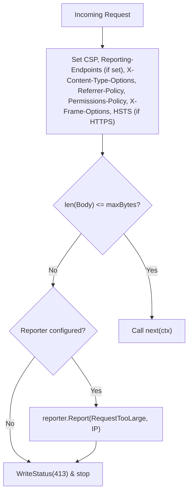

# Security Policy Middleware Flow

Context: `router/security` enforces response security headers and request size caps identically across origin (`server/httpd`) and edge (`cloudflare/edge`), and reports oversized requests (`413`) through `webtyp.com/securityevent`.

## Walkthrough

1. `Policy.Middleware()` emits all security headers on every response, including `require-trusted-types-for 'script'` and, when configured, hash-based `script-src 'sha384-...' 'strict-dynamic' 'wasm-unsafe-eval'`.
2. When `ReportEndpoint(path)` is set, the middleware emits `Reporting-Endpoints: csp="<path>"` and adds `report-to csp` to `Content-Security-Policy`.
3. Before calling `next`, `bodyAllowed` checks the body size cap; oversized requests trigger `securityevent.RequestTooLarge` (when a reporter is attached) and return `413`.
